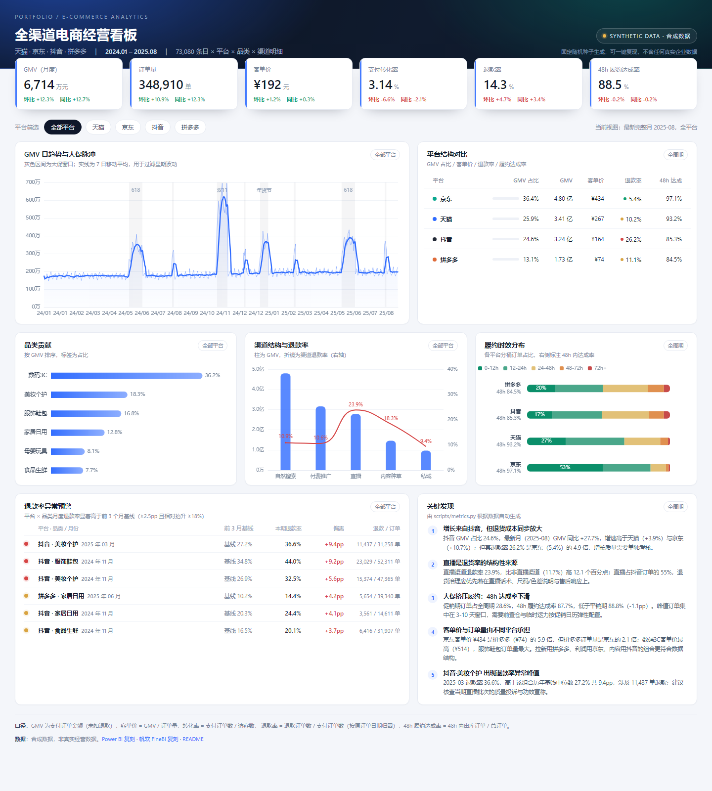

# 全渠道电商 KPI 看板

一个可复现的电商经营分析作品集：**固定种子生成多平台合成数据 → 计算指标 → 单文件离线 HTML 看板 → 在 Power BI / 帆软 FineBI 中复刻的完整配置说明**。

> 全部数据均为脚本生成的合成数据，不含任何真实企业、客户或个人信息。



## 项目定位

面向"电商运营 / 数据分析"岗位的作品集项目，重点不是做出几张图，而是展示一条完整的分析链路：

1. **数据建模**：日期 × 平台 × 品类 × 渠道的明细粒度，附履约时效分桶表与日历维表，可直接落成星型模型。
2. **指标口径**：每个指标的分子、分母与归因方式都写清楚，避免"同名指标不同算法"。
3. **异常发现**：用"前 3 个月基线 + 绝对/相对双阈值"识别退款率异动，而不是只画趋势图。
4. **交付能力**：单文件 HTML 双击即开（ECharts 已内联，无需联网），同时给出 Power BI / FineBI 的复刻步骤与 DAX / 计算字段公式。

## 快速开始

```bash
pip install -r requirements.txt

python scripts/generate_data.py     # 生成 data/*.csv（固定种子，结果可复现）
python scripts/metrics.py           # 计算指标，输出 data/metrics.json
python scripts/build_dashboard.py   # 内联数据与 ECharts，生成 dashboard/index.html
```

也可以直接双击打开已生成的 [dashboard/index.html](dashboard/index.html)（无需启动服务）。

重新运行数据脚本会得到完全一致的数据：随机种子 `20260101` 固定，促销日历与各平台参数写在脚本顶部。

## 目录结构

```
ecommerce-kpi-dashboard/
├── dashboard/
│   ├── index.html              # 单文件看板（构建产物，ECharts 与数据已内联）
│   ├── template.html           # 看板模板（占位符由构建脚本替换）
│   └── vendor/echarts.min.js   # ECharts 5.5.1（Apache-2.0）
├── data/
│   ├── fact_sales.csv          # 日期 × 平台 × 品类 × 渠道 销售明细（73,080 行）
│   ├── fact_fulfillment.csv    # 日期 × 平台 × 品类 履约时效分桶（72,101 行）
│   ├── dim_date.csv            # 日历维表（609 天，含促销窗口标记）
│   └── metrics.json            # metrics.py 输出的看板聚合数据
├── scripts/
│   ├── generate_data.py        # 合成数据生成（固定种子）
│   ├── metrics.py              # 指标计算 / 异常检测 / 结论生成
│   └── build_dashboard.py      # 单文件看板构建
├── docs/
│   ├── powerbi-replication.md  # Power BI 复刻：表关系、DAX 度量值、页面布局
│   ├── finebi-replication.md   # 帆软 FineBI 复刻：数据集、计算字段、组件配置
│   └── screenshots/            # 看板截图
└── requirements.txt
```

## 看板内容

- **总览 KPI**：GMV、订单量、客单价、支付转化率、退款率、48h 履约达成率，均带环比与同比。
- **GMV 日趋势**：7 日移动平均 + 大促窗口标注（618 / 双 11 / 年货节等）。
- **平台结构对比**：GMV 占比、客单价、退款率、履约达成率。
- **品类贡献**：按 GMV 排序并标注占比。
- **渠道结构与退款率**：直播 / 内容种草 / 自然搜索等渠道的 GMV 与退款率双轴对比。
- **履约时效分布**：0-12h / 12-24h / 24-48h / 48-72h / 72h+ 分桶占比，附 48h 达成率。
- **退款率异常预警**：平台 × 品类维度，对比前 3 个月基线，按偏离幅度排序。
- **关键发现**：由 `metrics.py` 根据数据自动生成，数字不是手写。

平台筛选（全部 / 天猫 / 京东 / 抖音 / 拼多多）会联动 KPI、趋势、品类、渠道与异常列表。

## 指标口径

| 指标 | 分子 | 分母 | 说明 |
| --- | --- | --- | --- |
| GMV | Σ 支付订单金额 | — | 下单口径，未扣退款；不是结算口径 |
| 订单量 | Σ 支付订单数 | — | 不含未支付、已取消订单 |
| 客单价（AOV） | GMV | 支付订单数 | 与"件单价"不同，按订单数摊 |
| 支付转化率 | 支付订单数 | 访客数 | 访客为各渠道 UV 直接相加，未跨渠道去重 |
| 退款率 | 退款订单数 | 支付订单数 | 按**原订单日期**归因，不按退款发生日 |
| 退款金额 | Σ 退款金额 | — | 按退款订单 × 客单价 × 0.92 估算 |
| 48h 履约达成率 | 0-12h + 12-24h + 24-48h 分桶订单数 | 总订单数 | 衡量出库时效，不包含配送在途 |
| 加权平均履约时长 | Σ(分桶订单 × 分桶中值) | 总订单数 | 分桶中值取 6 / 18 / 36 / 60 / 96 小时 |
| 平台贡献占比 | 平台 GMV | 全平台 GMV | 可替换为订单量占比，看板内置切换逻辑未做，属可扩展项 |
| 环比 | 本期值 − 上期值 | 上期值 | 最新完整月 vs 上月 |
| 同比 | 本期值 − 去年同期值 | 去年同期值 | 最新完整月 vs 去年同月，规避季节性 |

口径细节：退款率统一按订单归因，不把退款金额从 GMV 中扣除（GMV 与退款金额分开呈现），这样 GMV 与退款率可独立比较，不会因口径混用造成"增长但净值下滑"的误读。

## 数据说明

- **合成数据**：`scripts/generate_data.py` 生成，随机种子 `20260101`，重复运行结果一致。
- **时间范围**：2024-01-01 至 2025-08-31，共 609 天（20 个完整月，覆盖双 11、618、年货节等 8 个大促窗口，可计算同比）。
- **维度**：4 个公开电商平台（天猫 / 京东 / 抖音 / 拼多多）× 6 个品类 × 5 个渠道 × 609 天 = 73,080 行。
- **建模假设**：平台间客单价、转化率、退款率与履约时效存在系统性差异；大促日订单放大、退款率上升、履约时效变慢；抖音直播渠道退款率显著更高。
- **人为注入的异常**：抖音·美妆个护 2025-03 退款率 +9pp、抖音·服饰鞋包 2024-11 +6pp、拼多多·家居日用 2025-06 +3.5pp，用于验证异常检测逻辑是否有效。
- **明确边界**：数据不代表任何真实商家；平台名称仅作为公开的渠道标签使用。

## 结论摘要

1. **增长主要来自抖音，但退货成本同步放大。** 抖音 GMV 占比 24.6%，最新月（2025-08）同比 +27.7%，高于天猫 +3.9% 与京东 +10.7%；但退款率 26.2%，是京东（5.4%）的 4.9 倍。考核抖音不能只看 GMV，应把"退款后净 GMV"或"退款率"纳入同一看板。
2. **直播是退货率的结构性来源。** 直播渠道退款率 23.9%，比非直播渠道（11.7%）高 12.1pp；直播占抖音订单的 55%。退货治理应优先落在直播话术、尺码/色差说明与售后响应，而不是泛化到全渠道。
3. **大促挤压履约。** 促销期订单占全周期 28.6%，48h 履约达成率 87.7%，低于平销期 88.8%（-1.1pp）。峰值集中在 3-10 天窗口，需要按促销日历提前配置前置仓与临时运力。
4. **客单价与订单量由不同平台承担。** 京东客单价 ¥434 是拼多多（¥74）的 5.9 倍，但拼多多订单量是京东的 2.1 倍；数码 3C 客单价最高（¥514），服饰鞋包订单量最大。拉新靠拼多多、利润靠京东、内容靠抖音。
5. **异常检测能落到具体组合。** 2025-03 抖音·美妆个护退款率 36.6%，高于前 3 月基线 27.2% 共 9.4pp，涉及 11,437 单退款，可直接定位到当期直播批次做质量核查。

## Power BI / 帆软复刻

- [Power BI 复刻指引](docs/powerbi-replication.md)：表关系、日期表、20+ 个 DAX 度量值（GMV、客单价、退款率、48h 达成率、环比同比、平台占比、前 3 月基线异常标记）、页面布局与校验清单。
- [帆软 FineBI 复刻指引](docs/finebi-replication.md)：数据准备、计算字段、组件类型与字段拖拽配置、条件格式与联动。

## 技术栈与局限

Python 3.10+ / pandas / numpy / ECharts 5.5.1 / 原生 HTML+CSS+JS。截图由无头 Chrome 渲染。

已知局限：无成本与利润数据，因此不计算毛利与 ROI；退款按订单日期归因，未刻画退款滞后分布；访客未跨渠道去重，转化率只用于横向对比，不适合绝对值承诺。
