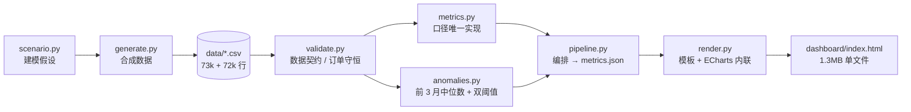
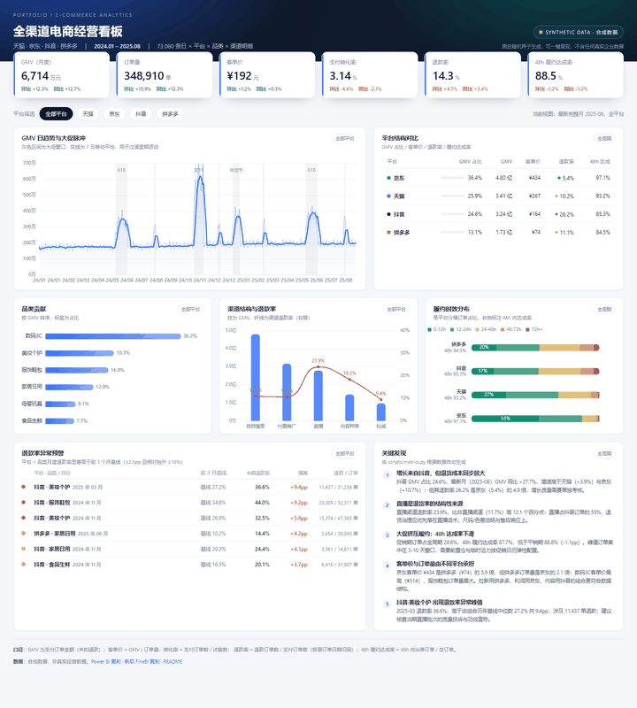

# 跨平台电商 KPI 看板

[](https://github.com/Jamorlant/ecommerce-kpi-dashboard/actions/workflows/ci.yml)


**把 4 个电商平台、20 个月的经营数据，压缩成一张 30 秒能读完、点得动、可复现的离线看板。**

它解决的不是"画图"，而是三个真实的分析问题：**多平台口径不一致**（GMV 该不该扣退款）、**大促后的退货异常发现太晚**、**履约承诺缺乏量化基线**。


> **数据声明：本仓库全部数据由脚本合成（`KPI_SEED=20260101`），不含任何真实企业、客户或个人信息。**
> 平台名（天猫/京东/抖音/拼多多）仅为公开品牌名，用于区分渠道结构，不代表任何真实平台的经营数据。
> 数字可用于验证方法，**不可用于引用真实大盘**。

---

## 30 秒速读

| 问题 | 做法 | 结果 |
| --- | --- | --- |
| 4 个平台、6 大品类、5 个渠道，日报和月报口径各说各话 | 把每个指标的分子/分母写成代码里的唯一实现，README、Power BI、FineBI 三处引用同一口径 | 6 个核心指标 + 3 个派生结构指标，口径表见下 |
| 大促后退货率抬头，靠人肉比对 Excel 才发现 | 月度 × 平台 × 品类，与**前 3 个月中位数**做双阈值对比 | 命中 6 条异常，最高 +9.4pp（抖音·美妆个护 2025-03） |
| 履约时效只有"快/慢"的模糊感知 | 5 个时效分桶 + 加权中值 + 48h 达成率 | 全周期 48h 达成率 88.5%，大促期低于平销 1.1pp |
| 作品集里放 BI 截图但对方打不开 | 单文件 HTML，ECharts 与数据全部内联 | **1.3MB、零依赖、双击即开**，也可直接托管到 GitHub Pages |

规模：**20 个月 × 4 平台 × 6 品类 × 5 渠道 = 73,080 行销售明细 + 72,101 行履约分桶**，全期 GMV 13.18 亿元 / 670.6 万单。

---

## 业务痛点（为什么做这个）

1. **口径之争消耗在会议里**。退款是按下单日还是退款日归因？GMV 要不要扣退款？不同团队各算一套，数字永远对不上。
2. **异常发现依赖人工**。大促后退货率整体抬升是常态，人工很难区分"正常普涨"和"某个平台某个品类真的出问题"。
3. **履约承诺无法量化**。客服承诺"48 小时发货"，但没有任何一张图能说明达标率是多少、大促掉多少。
4. **增长结构判断靠感觉**。抖音涨得快，但涨的是 GMV 还是退货？京东客单价高，但单量贡献多少？需要一张同时回答"规模、质量、效率"的图。

---

## 指标口径（先看这张表）

所有指标只有**一个实现**：[`ecommerce_kpi/metrics.py`](ecommerce_kpi/metrics.py)。README、Power BI DAX、FineBI 计算字段都从这里对齐。

| 指标 | 分子 | 分母 | 为什么这样定义 |
| --- | --- | --- | --- |
| GMV | Σ 支付订单金额 `gmv` | — | 支付口径，**不扣退款**；退款单独作为质量指标，避免"卖得越多、GMV 越小"的荒谬结论 |
| 订单量 | Σ 支付订单数 `orders` | — | 与 GMV 同口径，客单价才可解释 |
| 客单价 AOV | GMV | 订单量 | 结构变化的直接指示器 |
| 支付转化率 | 支付订单数 | 访客数 | 访客按渠道分别记录、**未跨渠道去重**，因此是"渠道口径"，会高于全站真实转化率（已列入已知限制） |
| 退款率 | 退款订单数 | 支付订单数 | **按原订单日期归因**，不是退款发生日；否则大促月的退款会污染次月 |
| 退款金额 | Σ `refund_amount` | — | 便于估算对利润的绝对冲击，而不只是比率 |
| 48h 履约达成率 | 0-12h + 12-24h + 24-48h 分桶订单 | 全部分桶订单 | 对客承诺的最小可执行口径；分母与销售订单数在数据层一一对应 |
| 加权履约时长 | Σ(分桶订单 × 6/18/36/60/96h) | 全部分桶订单 | 用分桶中值加权，避免用边界值造成系统性高估/低估 |
| 平台 GMV 占比 | 平台 GMV | 全平台 GMV | 描述结构，不评价好坏 |
| 环比 / 同比 | 本期 − 对比期 | 对比期 | 同比取**去年同月**（20 个月数据），规避季节性造成的假增长 |
| 退款异常 | 当月退款率 − 前 3 个月中位数 | — | 双阈值：绝对 ≥ 2.5pp **且** 相对 ≥ 18%，防止把大促普涨误报成异常 |

> 为什么"先汇总分子分母再相除"：直接对每日比率取平均会给小体量日期过高权重（Simpson 悖论），因此所有比率都在聚合层重算。

---

## 架构



设计取舍写在 [docs/architecture.md](docs/architecture.md)：为什么单文件而不是 Web 应用、为什么事实表要拆成销售 + 履约、为什么异常检测用中位数基线。

---

## 快速开始

### 路径 A：零安装，直接看（推荐给 HR / 面试官）

双击打开 [`dashboard/index.html`](dashboard/index.html)，或把它拖进浏览器。无需 Python、无需服务端、无需联网。

### 路径 B：改数据，重跑（推荐给技术面试官）

```bash
pip install -r requirements.txt
python -m ecommerce_kpi all
```

第三条命令把"生成数据 → 计算指标 → 构建看板"串起来，产物写回 `data/*.csv`、`data/metrics.json`、`dashboard/index.html`。

- 以 `KPI_SEED=20260101` 重跑，产物**逐字节一致**（CI 用 `git diff --exit-code` 强制执行）。
- 换周期/换种子：复制 `.env.example` 为 `.env` 后修改，详见[配置说明](#配置)。
- 有 `make` 的环境可用 `make setup && make all`（Windows 用上面两条 `python -m` 即可）。

### 配置

| 变量 | 默认值 | 说明 |
| --- | --- | --- |
| `KPI_SEED` | `20260101` | 随机种子，决定全部数据 |
| `KPI_START_DATE` / `KPI_END_DATE` | `2024-01-01` / `2025-08-31` | 数据周期；**至少 13 个完整月**，否则同比无法计算会显式报错 |
| `KPI_DATA_DIR` / `KPI_DASHBOARD_DIR` | `data` / `dashboard` | 产物路径 |
| `KPI_LOG_LEVEL` | `INFO` | `DEBUG` 会打印逐文件写入细节 |

本仓库不含任何密钥，`.env` 只承载运行参数；`.env` 已加入 `.gitignore`。

---

## 看板包含什么

| 区块 | 内容 | 交互 |
| --- | --- | --- |
| 6 张 KPI 卡 | 月度 GMV、订单量、客单价、转化率、退款率、48h 达成率，附环比/同比 | 随平台筛选联动 |
| GMV 趋势 | 日粒度折线 + 7 日移动平均，大促窗口以灰色区间标注 | 随平台筛选联动 |
| 平台对比 | 占比、GMV、客单价、退款率、履约达成率 | 全局 |
| 品类贡献 / 渠道结构 | 品类 GMV 条形图；渠道 GMV 柱 + 退款率折线（组合图） | 随平台筛选联动 |
| 履约时效分布 | 5 档 100% 堆叠条，标注每档占比与 48h 达成率 | 随平台筛选联动 |
| 退款异常预警 | 平台/品类/月份、前 3 月基线、本期退款率、偏离 pp、退款单量 | 随平台筛选联动 |
| 关键发现 | 由 `insights.py` 从数据生成，非手写 | 全局 |

筛选联动效果（4 个平台状态依次切换）：



单页状态截图：[天猫](docs/screenshots/dashboard-tmall.png) · [京东](docs/screenshots/dashboard-jd.png) · [抖音](docs/screenshots/dashboard-douyin.png) · [拼多多](docs/screenshots/dashboard-pdd.png)

---

## 数据能说明什么（结论摘要）

1. **增长来自抖音，但退货成本同步放大**：抖音 GMV 占比 24.6%，最新月同比 +27.7%（天猫 +3.9%、京东 +10.7%），但退款率 26.2%，是京东（5.4%）的 4.9 倍。
2. **直播是退货率的结构性来源**：直播退款率 23.9%，高出非直播渠道 12.1pp；直播占抖音订单 55%，治理应落在话术、尺码/色差说明与售后响应。
3. **大促挤压履约**：促销期占订单 28.6%，48h 达成率 87.7%，低于平销期 88.8%；峰值需要按促销日历弹性配置前置仓与运力。
4. **客单价与订单量由不同平台承担**：京东客单价 ¥434 是拼多多（¥74）的 5.9 倍，拼多多单量却是京东的 2.1 倍；数码3C 客单价最高（¥514），服饰鞋包单量最大。
5. **异常可被定位到"平台 × 品类 × 月份"**：2025-03 抖音·美妆个护退款率 36.6%，高于基线中位数 27.2% 共 9.4pp，涉及 11,437 单退款。

> 注意：以上结论描述的是**合成数据中建模假设的结果**（平台差异、退款差异、促销强度、大促退款放大等都是 `scenario.py` 里设定的），用于演示分析方法，不能外推为真实平台规律。

---

## 技术选型与理由

| 选择 | 理由 | 代价 |
| --- | --- | --- |
| Python + pandas | 指标计算与检验最直接；核心逻辑可被 pytest 精确覆盖 | 需要 Python 3.11+ 环境 |
| 单文件 HTML + 内联 ECharts | 读者零门槛（双击即开）、可离线、可直接托管 Pages；不需要构建链 | 产物 1.3MB 入库；ECharts 需手动升级 |
| 不引入 React / Vite | 只有一个页面、无路由、无状态管理，构建链只会增加读者负担 | 后续做多页面时需要自行演进 |
| 不引入 Streamlit / Dash | 需要起服务，且默认样式难以做到"能放进作品集"的程度 | 无实时刷新能力 |
| argparse + 标准库日志 | 4 个子命令不值得引入 CLI 框架；退出码 0/1/2 区分成功、缺陷、数据契约问题 | 无插件机制 |
| pytest + ruff + GitHub Actions | 覆盖核心口径、异常检测、构建占位符；CI 同时校验"重建结果逐字节一致" | 依赖版本需锁定，升级需改 `requirements*.txt` |

---

## 工程规范

- **分层**：`scenario`（假设）→ `generate`（造数）→ `validate`（契约）→ `metrics`/`anomalies`/`insights`（纯计算）→ `pipeline`（编排）→ `render`（构建）。纯计算模块不碰文件，可单测。
- **类型标注**：全部公开函数带类型；`mypy` 级别的严格度未开启（避免为作品集引入额外工具链），以 ruff + 测试为准。
- **错误处理**：数据契约问题抛 `DataContractError`，CLI 退出码 2 并只打印一行原因；未预期异常记录完整栈，退出码 1。
- **日志分级**：`INFO` 记录各阶段产物与规模，`WARNING` 记录异常命中与订单守恒偏差，`DEBUG` 记录逐文件写入。
- **测试**：19 个用例覆盖口径公式、异常双阈值、种子可复现、履约订单守恒、看板占位符替换。
- **CI**（[ci.yml](.github/workflows/ci.yml)）：`ruff check` + `ruff format --check` + `pytest` + 全流程重建 + 产物逐字节比对 + 单文件自包含校验。
- **提交与评审**：规范的 [PR 模板](.github/pull_request_template.md)，要求说明"是否改变口径、是否同步 README 与 BI 文档"。

---

## 目录结构

```
ecommerce-kpi-dashboard/
├─ dashboard/
│  ├─ index.html          # 构建产物：内联 ECharts + 数据，1.3MB，可离线打开
│  ├─ template.html       # 看板模板（占位符 __DATA_JSON__ / __ECHARTS__）
│  └─ vendor/echarts.min.js
├─ data/
│  ├─ fact_sales.csv      # 销售事实：日期×平台×品类×渠道
│  ├─ fact_fulfillment.csv# 履约事实：日期×平台×品类×时效分桶
│  ├─ dim_date.csv        # 日历维表（含促销标记）
│  └─ metrics.json        # 指标与看板数据的唯一来源
├─ ecommerce_kpi/         # 分析流水线（可 python -m 运行）
│  ├─ scenario.py         # 建模假设（平台/品类/促销/退款基线）
│  ├─ generate.py         # 合成数据
│  ├─ validate.py         # 数据契约
│  ├─ metrics.py          # 口径唯一实现
│  ├─ anomalies.py        # 退款异常检测
│  ├─ insights.py         # 结论生成
│  ├─ pipeline.py         # 编排 → metrics.json
│  ├─ render.py           # 构建单文件看板
│  └─ cli.py              # generate / metrics / render / all
├─ tests/                 # pytest：口径、异常、造数、构建
├─ docs/
│  ├─ architecture.md     # 给面试官：设计取舍与扩展点
│  ├─ powerbi-replication.md
│  ├─ finebi-replication.md
│  └─ screenshots/
├─ .github/               # CI + PR 模板
├─ .env.example / Makefile / pyproject.toml
└─ requirements.txt / requirements-dev.txt
```

---

## 已知限制

- **数据是合成的**，结论只验证方法，不能代表真实电商大盘。
- **访客未跨渠道去重**，转化率是渠道口径，数值偏高。
- **履约时效是分桶数据**，加权时长用分桶中值近似；真实系统应按订单级时间戳计算。
- **异常检测是经验规则**（中位数基线 + 双阈值），未做统计显著性检验；对长期结构变化（如整体退货率持续上升）不敏感。
- **单文件 1.3MB**：首屏加载依赖浏览器解析内联脚本，弱设备约 1 秒；未做移动端断点适配（按 1440px 设计）。
- **没有后端与实时数据**，刷新需重跑脚本；BI 复刻仅提供文档，不含 `.pbix` / FineBI 工程文件。
- 同比要求 ≥13 个完整月，短周期数据会直接报错而不是给出误导性数字。

---

## 延伸阅读

- [架构与设计取舍](docs/architecture.md) — 给面试官：为什么这样分层、哪些地方刻意不抽象、如何扩展到真实数据源。
- [Power BI 复刻指引](docs/powerbi-replication.md) — 星型模型、关系、DAX（GMV / 客单价 / 退款率 / 环比同比 / RANKX / 异常标记）、页面布局与校验值。
- [FineBI 复刻指引](docs/finebi-replication.md) — 数据关联、计算字段、8 个组件配置、条件格式，以及"FineBI 无窗口函数"时的近似方案。

## 许可与致谢

- ECharts 5.5.1，Apache-2.0，已内联至单文件产物。
- 平台名称仅作为公开品牌标识用于区分渠道，不涉及任何平台的内部数据。
